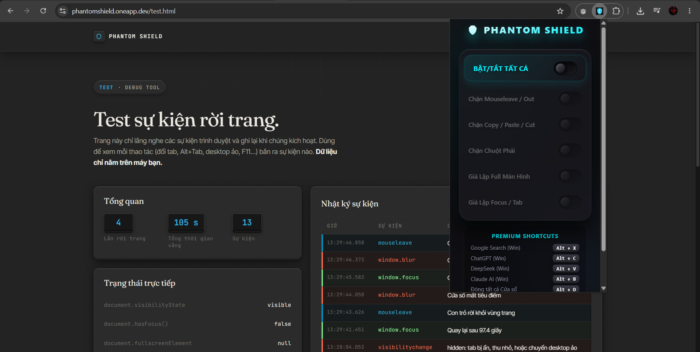
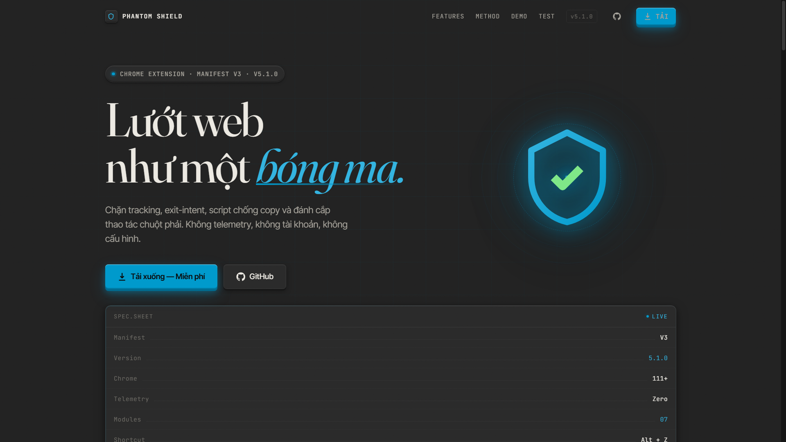
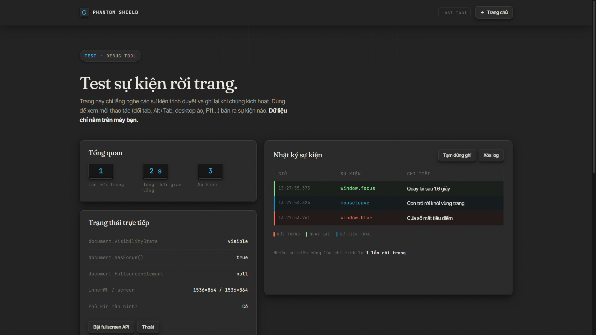
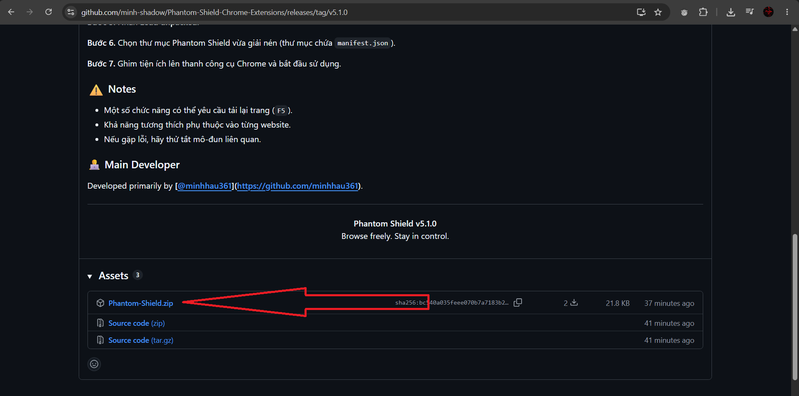
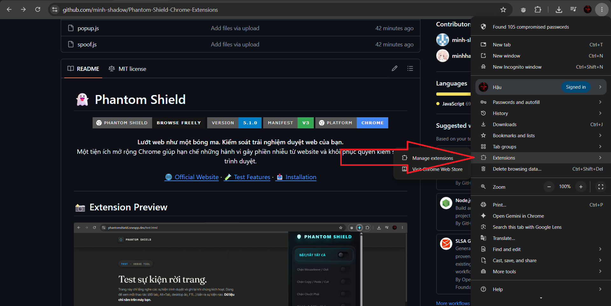
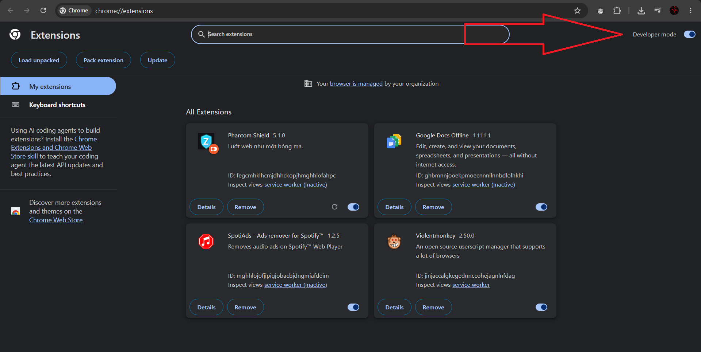
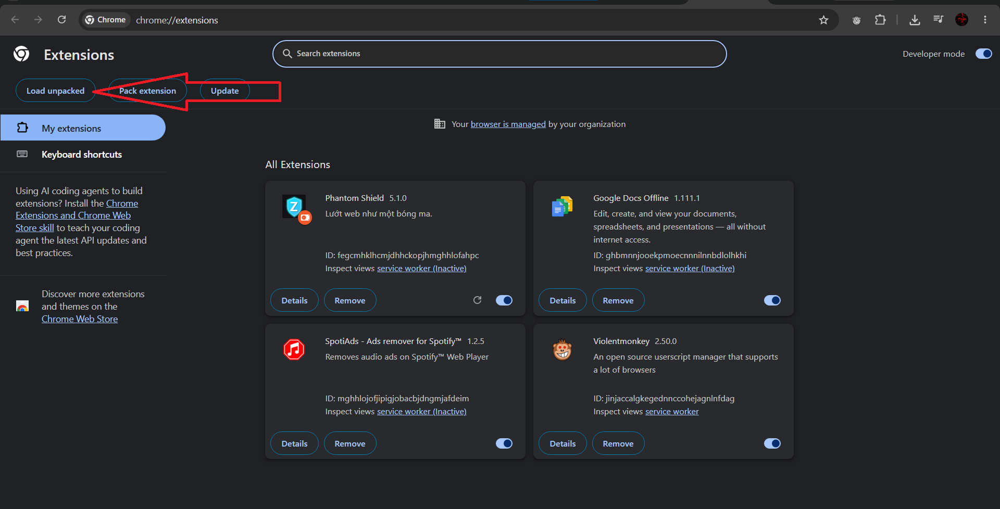
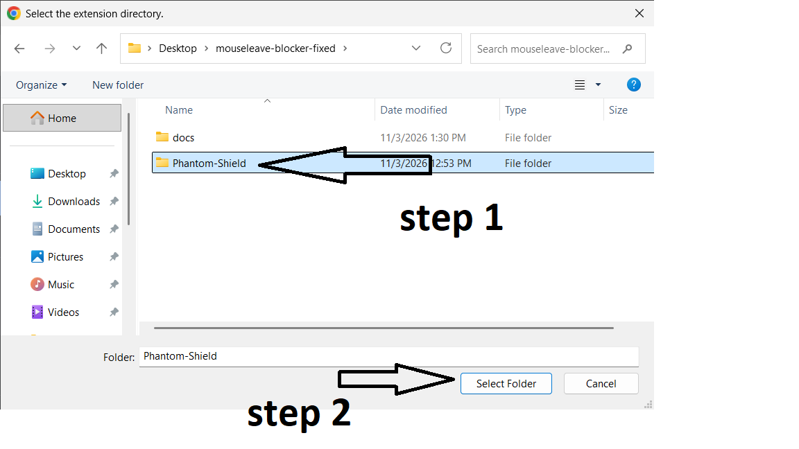

# 👻 Phantom Shield 

<p align="center">
  
  
  
  
</p>

<p align="center">
  <strong>Lướt web như một bóng ma. Kiểm soát trải nghiệm duyệt web của bạn.</strong>
  <br>
  Một tiện ích mở rộng Chrome giúp hạn chế những hành vi gây phiền nhiễu từ website và khôi phục quyền kiểm soát trình duyệt.
</p>

<p align="center">
  <a href="https://phantomshield.oneapp.dev/">🌐 Official Website</a>
  ·
  <a href="https://phantomshield.oneapp.dev/test.html">🧪 Test Features</a>
  ·
  <a href="#-installation">📥 Installation</a>
</p>

---

## 📸 Extension Preview

<p align="center">
  <!-- TODO: UPLOAD ẢNH GIAO DIỆN TIỆN ÍCH PHANTOM SHIELD -->
  
</p>

<p align="center">
  <i>Phantom Shield – Browse Freely. Stay in Control.</i>
</p>

---

## 🌐 Official Website & Testing

Phantom Shield không chỉ là một tiện ích mở rộng Chrome mà còn có website riêng để giới thiệu dự án và cung cấp môi trường kiểm thử các chức năng.

### 🏠 Official Website

<p align="center">
  <a href="https://phantomshield.oneapp.dev/">
    <!-- TODO: UPLOAD ẢNH CHỤP TRANG CHỦ WEBSITE TẠI ĐÂY -->
    
  </a>
  <br>
  <strong><a href="https://phantomshield.oneapp.dev/">Visit Official Website →</a></strong>
</p>

Website chính thức: https://phantomshield.oneapp.dev/

### 🧪 Feature Testing Page

<p align="center">
  <a href="https://phantomshield.oneapp.dev/test.html">
    <!-- TODO: UPLOAD ẢNH CHỤP TRANG TEST TẠI ĐÂY -->
    
  </a>
  <br>
  <strong><a href="https://phantomshield.oneapp.dev/test.html">Open Testing Page →</a></strong>
</p>

Trang kiểm thử cho phép người dùng trực tiếp trải nghiệm và kiểm tra các hành vi mà Phantom Shield hướng tới xử lý.

---

## 📖 About

**Phantom Shield** là tiện ích mở rộng dành cho Google Chrome, được xây dựng nhằm hạn chế một số hành vi JavaScript có thể can thiệp vào trải nghiệm duyệt web của người dùng.

Một số website sử dụng JavaScript để:

- Chặn thao tác chuột phải.
- Can thiệp vào clipboard.
- Hiển thị popup gây phiền nhiễu.
- Theo dõi trạng thái focus của cửa sổ.
- Kiểm tra trạng thái fullscreen của trình duyệt.

Phantom Shield cung cấp các mô-đun bảo vệ độc lập, giúp người dùng chủ động quản lý những hành vi này thông qua một giao diện điều khiển đơn giản.

> **Our Philosophy:** Your browser belongs to you.

---

## ✨ Features

Phantom Shield được giới thiệu với 7 mô-đun chức năng chính:

| # | Feature | Description |
|:---:|---|---|
| 01 | **Exit-Intent Protection** | Hạn chế popup và sự kiện gây phiền nhiễu khi người dùng có ý định rời khỏi trang. |
| 02 | **Clipboard Protection** | Hạn chế website can thiệp vào thao tác Copy, Cut và Paste. |
| 03 | **Right-Click Restore** | Khôi phục menu chuột phải mặc định khi website chặn bằng JavaScript. |
| 04 | **Fullscreen Spoofing** | Điều chỉnh thông tin fullscreen mà website nhận được. |
| 05 | **Focus Spoofing** | Điều chỉnh thông tin trạng thái focus và visibility. |
| 06 | **Global Hotkey** | Sử dụng `Alt + Z` để chuyển đổi nhanh trạng thái bảo vệ. |
| 07 | **Control Panel** | Giao diện popup quản lý các chức năng riêng biệt. |

### ⚡ Quick Controls

| Action | Shortcut |
|---|---|
| Toggle protection | `Alt + Z` |
| Manage individual modules | Extension Popup |

*Một số mô-đun có thể yêu cầu tải lại trang để áp dụng đầy đủ.*

---

## 👨‍💻 Creator & Main Developer

<p align="center">
  <a href="https://github.com/minhhau361">
    
  </a>
  <br>
  <strong><a href="https://github.com/minhhau361">@minhhau361</a></strong>
  <br>
  Project Creator · Main Developer
</p>

**[@minhhau361](https://github.com/minhhau361)** là người sáng lập, đóng góp chính và chịu trách nhiệm phát triển cốt lõi của Phantom Shield.

### Main Contributions

- Xây dựng ý tưởng và định hướng phát triển dự án.
- Phát triển kiến trúc Chrome Extension.
- Triển khai các mô-đun bảo vệ và xử lý sự kiện.
- Xây dựng cơ chế tương tác với môi trường JavaScript của website.
- Thiết kế giao diện và trải nghiệm người dùng.
- Tối ưu hiệu năng, sửa lỗi và bảo trì dự án.

---

## 🛠️ Technology Stack

| Technology | Purpose |
|---|---|
| JavaScript | Core logic and functionality |
| HTML5 | Interface structure |
| CSS3 | UI styling |
| Chrome Extension API | Browser integration |
| Manifest V3 | Extension architecture |
| Chrome Storage API | Local configuration |
| Shadow DOM | UI isolation |

---

## 📥 Installation

Phantom Shield có thể được cài đặt trực tiếp từ mã nguồn thông qua **Chrome Developer Mode**.

### Requirements

- Google Chrome 111 trở lên.
- Windows, macOS hoặc Linux.
- Source code của Phantom Shield.

### Step 1 – Download Source Code

Clone repository:

```bash
git clone https://github.com/minhhau361/phantom-shield.git
```

Hoặc tải mã nguồn bằng cách chọn:

`Code → Download ZIP`

<p align="center">
  <!-- TODO: UPLOAD ẢNH MINH HỌA TẢI SOURCE CODE ZIP -->
  
</p>

### Step 2 – Open Chrome Extensions

Mở Chrome và truy cập:

```text
chrome://extensions/
```

<p align="center">
  <!-- TODO: UPLOAD ẢNH TRANG CHROME EXTENSIONS -->
  
</p>

### Step 3 – Enable Developer Mode

Bật **Developer mode** ở góc trên bên phải trang quản lý tiện ích.

<p align="center">
  <!-- TODO: UPLOAD ẢNH BẬT DEVELOPER MODE -->
  
</p>

### Step 4 – Load Unpacked

Nhấn **Load unpacked**, sau đó chọn thư mục chứa mã nguồn Phantom Shield đã giải nén.

<p align="center">
  <!-- TODO: UPLOAD ẢNH LOAD UNPACKED VÀ CHỌN THƯ MỤC -->
  
</p>

### Step 5 – Start Using Phantom Shield

Sau khi cài đặt thành công, Phantom Shield sẽ xuất hiện trong danh sách tiện ích.

Ghim tiện ích lên thanh công cụ Chrome để truy cập nhanh.

<p align="center">
  <!-- TODO: UPLOAD ẢNH PHANTOM SHIELD SAU KHI CÀI ĐẶT THÀNH CÔNG -->
  
</p>

<details>
<summary><strong>📌 Installation Notes</strong></summary>

- Đảm bảo chọn đúng thư mục chứa `manifest.json`.
- Không chọn thư mục cha nếu mã nguồn nằm trong thư mục con.
- Nếu tiện ích không xuất hiện, kiểm tra lỗi tại `chrome://extensions/`.
- Khi cập nhật mã nguồn, nhấn nút Reload trên thẻ tiện ích.

</details>

---

## 🎮 Usage Guide

1. Nhấn biểu tượng Phantom Shield trên thanh công cụ Chrome.
2. Mở Control Panel.
3. Bật hoặc tắt các mô-đun theo nhu cầu.
4. Sử dụng `Alt + Z` để chuyển đổi nhanh.
5. Tải lại trang nếu mô-đun yêu cầu khởi tạo lại môi trường JavaScript.

### Module Activation

| Module | Activation |
|---|---|
| Exit-Intent Protection | Có thể áp dụng ngay |
| Clipboard Protection | Có thể áp dụng ngay |
| Right-Click Restore | Có thể áp dụng ngay |
| Fullscreen Spoofing | Có thể cần tải lại trang |
| Focus Spoofing | Có thể cần tải lại trang |

---

## ⚙️ Technical Overview

Phantom Shield sử dụng JavaScript và Chrome Extension API để triển khai các mô-đun chức năng.

### 1. Event Capture

Sử dụng Capture Phase kết hợp với:

```javascript
event.stopImmediatePropagation();
```

Giúp hạn chế các listener khác tiếp tục xử lý một số sự kiện được bảo vệ.

### 2. Main World Injection

Content Script của Chrome chạy trong môi trường Isolated World. Phantom Shield sử dụng Main World Injection để tương tác với môi trường JavaScript của website.

Một trong những API được sử dụng:

```javascript
Object.defineProperty();
```

### 3. Shadow DOM

Toast Notification sử dụng Shadow DOM với Closed Shadow Root nhằm cô lập cấu trúc và CSS khỏi website.

### 4. UI State Synchronization

Sử dụng biến trạng thái `isUpdatingUI` để hạn chế xung đột trong quá trình đồng bộ cài đặt từ Chrome Storage với giao diện.

---

## 🔒 Privacy & Security

Phantom Shield hướng tới trải nghiệm sử dụng tối giản và hạn chế thu thập dữ liệu.

Theo thiết kế được công bố:

- Không yêu cầu người dùng tạo tài khoản.
- Không sử dụng hệ thống telemetry.
- Không thực hiện kết nối mạng bên ngoài.
- Cấu hình được lưu bằng `chrome.storage.local`.

**Lưu ý:** Người dùng nên kiểm tra mã nguồn thực tế, `manifest.json` và các quyền được yêu cầu trước khi cài đặt.

### Compatibility Limitations

| Situation | Notes |
|---|---|
| Google Meet & Banking Websites | Có thể phát hiện các thuộc tính JavaScript bị ghi đè. |
| Inline HTML Event Handlers | Một số handler như `onclick` có thể không bị ảnh hưởng. |
| Iframe | Phím tắt có thể không hoạt động trong một số iframe. |
| Fullscreen & Focus | Có thể yêu cầu tải lại trang. |

Phantom Shield không đảm bảo hoạt động giống nhau trên mọi website.

Không sử dụng tiện ích để vượt qua cơ chế bảo mật, kiểm soát truy cập hoặc các biện pháp bảo vệ hợp pháp của website.

---

## 🤝 Contributing

Mọi đóng góp nhằm cải thiện Phantom Shield đều được hoan nghênh.

### How to Contribute

1. Fork repository.
2. Tạo branch mới.
3. Thực hiện chỉnh sửa và kiểm thử.
4. Commit các thay đổi.
5. Push branch và tạo Pull Request.

```bash
git checkout -b feature/new-feature

git add .

git commit -m "feat: add new feature"

git push origin feature/new-feature
```

Nếu phát hiện lỗi, hãy tạo GitHub Issue kèm theo:

- Mô tả lỗi.
- Các bước tái hiện.
- Phiên bản Chrome.
- Hình ảnh hoặc thông tin liên quan.

---

## 📜 License

Dự án được giới thiệu với MIT License.

Vui lòng kiểm tra file `LICENSE` trong repository để xác nhận điều khoản cấp phép chính thức.

---

## ⭐ Support the Project

Nếu bạn thấy Phantom Shield hữu ích, hãy dành một chút thời gian để hỗ trợ dự án:

- ⭐ Star repository.
- 🐛 Báo cáo lỗi qua Issues.
- 💡 Đề xuất tính năng mới.
- 🔀 Đóng góp mã nguồn qua Pull Requests.

<p align="center">
  <a href="https://github.com/minhhau361/phantom-shield/stargazers">
    
  </a>
</p>

---

<p align="center">
  <strong>👻 Phantom Shield</strong>
  <br>
  <i>Browse Freely. Stay in Control.</i>
  <br><br>
  Created & Developed with dedication by
  <br>
  <a href="https://github.com/minhhau361"><strong>@minhhau361</strong></a>
  <br><br>
  <a href="https://phantomshield.oneapp.dev/">Official Website</a>
  ·
  <a href="https://phantomshield.oneapp.dev/test.html">Testing Page</a>
  ·
  <a href="https://github.com/minhhau361/phantom-shield">GitHub Repository</a>
</p>
